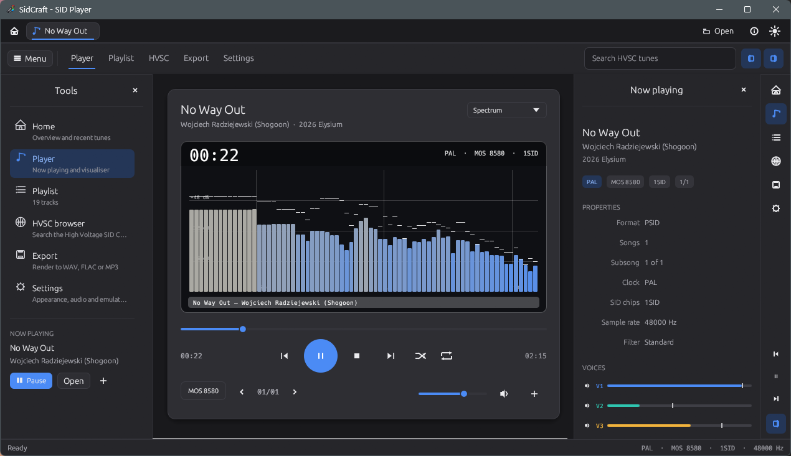

#  SidCraft

SidCraft is a Rust-based desktop player for Commodore 64 SID music files in PSID and RSID formats. Because it emulates the SID chip's audio itself, local files can be played without an internet connection. The built-in HVSC browser, however, requires a connection to an online HVSC mirror.

## Features

- Open SID files, switch between subsongs, and open files from the OS (Open with, Finder, file manager, or command line). Only one instance runs: opening another file replaces the tune in the open window.
- Drag and drop SID files or M3U playlists onto the main window or mini player. Mixed SID/M3U drops are rejected.
- Emulate C64 SID audio, including tunes that use one, two, or three SID chips. Choose the SID model and the EKV or standard MOS 6581 filter, which is remembered between sessions.
- Play, pause, stop, and seek. Shuffle and repeat playback.
- Create, manage, and save M3U playlists.
- Browse and search an HVSC mirror by title, author, or path. Download tunes from the browser and play them.
- Generate random playlists from the HVSC index (5–100 tracks, from Demos, Games, and/or Musicians) and save them to the library.
- Choose from eight visualisations: envelope, VU meter, spectrum, spectrogram, oscilloscope, piano roll, filter, and ADSR.
- Use a frameless mini player (Ctrl+M) with transport controls, a progress bar, and a compact visualisation. Resize it, adjust its opacity, or set it to start on launch.
- Export tunes to WAV, FLAC, or MP3, with control over duration, fade-out, sample rate, and gain. Mute individual voices.
- Check for updates from GitHub, automatically or on demand. Updates are verified with SHA-256 before installation.
- Choose system, light, or dark theme.

   
## Documentation

See [docs/DOCUMENTATION.md](docs/DOCUMENTATION.md) for the feature overview,
FFmpeg requirements and build instructions for Windows, Linux and macOS.

## License

SidCraft is licensed under the GNU General Public License v3.0 only. See [LICENSE](LICENSE) for the full text.

## Acknowledgements and third-party code

**crabsid** — The `src/engine/` directory (excluding `export.rs`) contains files derived from [crabsid](https://github.com/mlund/crabsid) by Mikael Lund, which are licensed under the MIT License. These files retain their original copyright notices, and those that were modified are additionally marked as derived from crabsid. The original MIT license text is included in [licenses/MIT-crabsid.txt](licenses/MIT-crabsid.txt).

**PdfCraft** — `src/theme.rs` contains design tokens derived from [PdfCraft](https://github.com/storytold/pdfcraft) (crate `ui-egui`, file `src/theme.rs`), Copyright (c) 2026 ArtCraft Team and the PdfCraft contributors, licensed MIT OR Apache-2.0. The MIT option is elected so the derived code can be combined into this GPL-3.0-only work. `src/ui.rs` and `src/main.rs` only follow PdfCraft's shell layout grammar and contain no copied code. The licence texts are included in [licenses/LICENSE-PDFCRAFT-MIT.txt](licenses/LICENSE-PDFCRAFT-MIT.txt) and [licenses/LICENSE-PDFCRAFT-APACHE-2.0.txt](licenses/LICENSE-PDFCRAFT-APACHE-2.0.txt).

**Full list:** [licenses/ATTRIBUTION.md](licenses/ATTRIBUTION.md)
