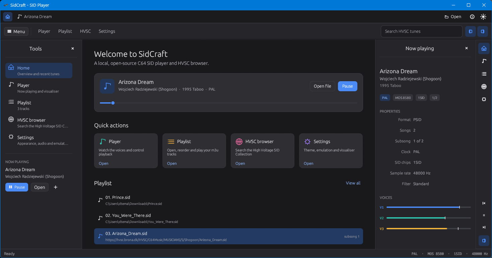

#  SidCraft

## Documentation

See [docs/DOCUMENTATION.md](docs/DOCUMENTATION.md) for what SidCraft does, the
full feature list, screenshots and build instructions for Windows, Linux and
macOS.

## License

SidCraft is licensed under the GNU General Public License v3.0 only. See [LICENSE](LICENSE) for the full text.

## Acknowledgements and third-party code

**crabsid** — The `src/engine/` directory contains files derived from [crabsid](https://github.com/mlund/crabsid) by Mikael Lund, which are licensed under the MIT License. Files in this directory retain their original copyright notices. Files that were modified are additionally marked as derived from crabsid. The original MIT license text is included in [licenses/MIT-crabsid.txt](licenses/MIT-crabsid.txt).

**PdfCraft** — `src/theme.rs` contains design tokens derived from [PdfCraft](https://github.com/storytold/pdfcraft) (crate `ui-egui`, file `src/theme.rs`), Copyright (c) 2026 ArtCraft Team and the PdfCraft contributors, licensed MIT OR Apache-2.0. The MIT option is elected so the derived code can be combined into this GPL-3.0-only work. `src/ui.rs` and `src/main.rs` only follow PdfCraft's shell layout grammar and contain no copied code. The licence texts are included in [licenses/LICENSE-PDFCRAFT-MIT.txt](licenses/LICENSE-PDFCRAFT-MIT.txt) and [licenses/LICENSE-PDFCRAFT-APACHE-2.0.txt](licenses/LICENSE-PDFCRAFT-APACHE-2.0.txt).

**Full list:** [licenses/ATTRIBUTION.md](licenses/ATTRIBUTION.md)