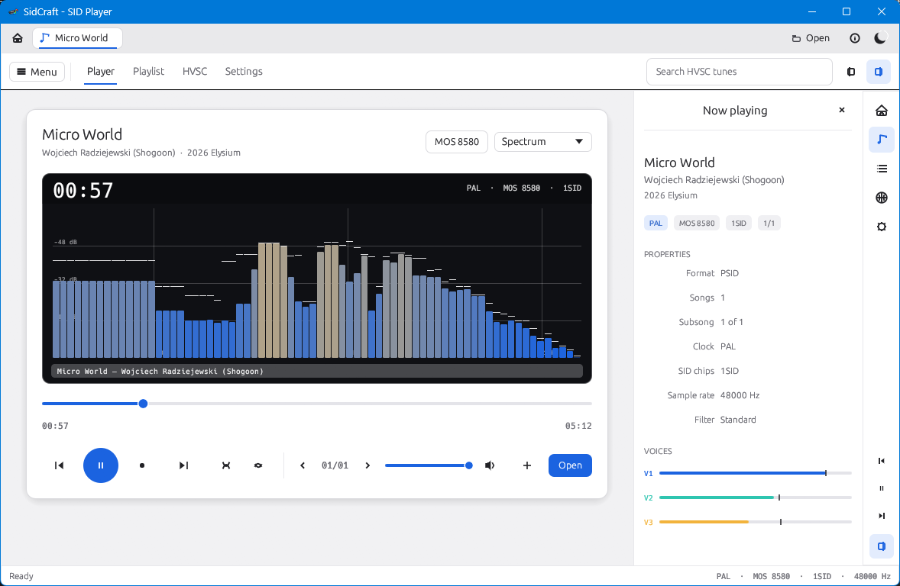
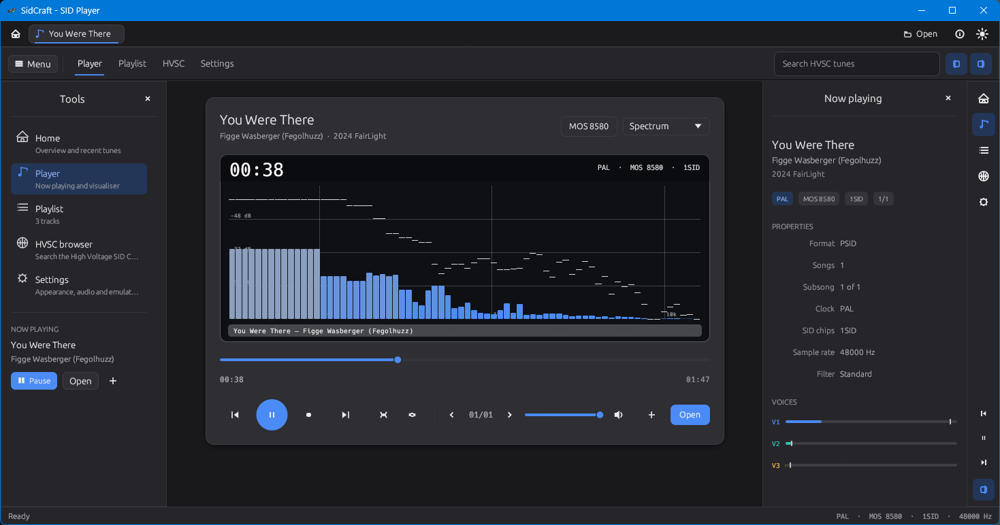
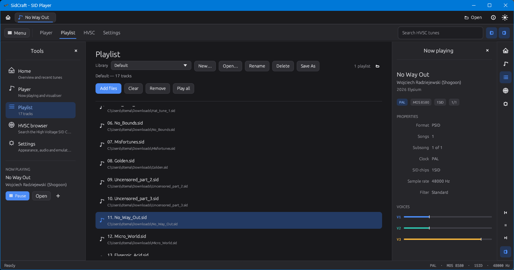
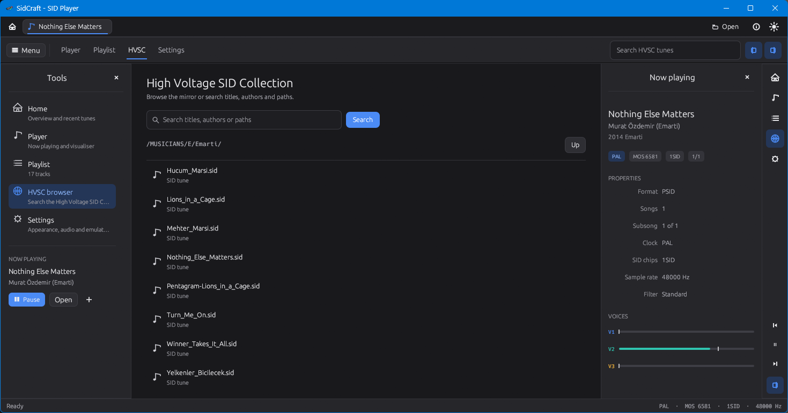
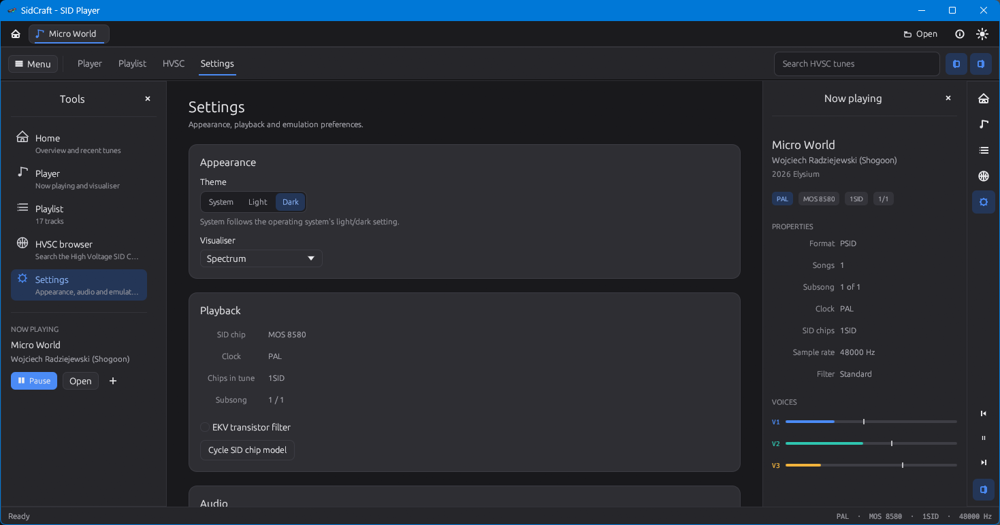
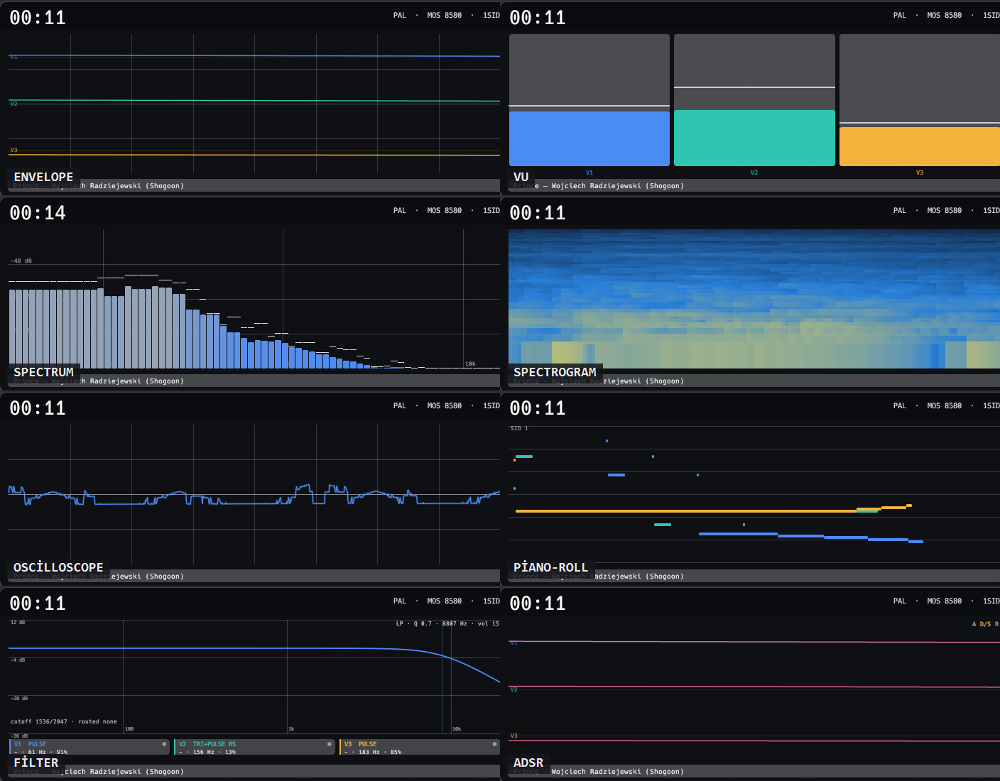

# SidCraft Documentation

> This document continues the README. For the licence and third-party notices,
> see [README.md](../README.md).

## 1. What is SidCraft?

**SidCraft** is a desktop player for Commodore 64 SID music files — both PSID
and RSID formats — that works fully offline. At the same time it doubles as a
browser for the [High Voltage SID Collection (HVSC)](https://hvsc.brona.dk/)
archive.

The application does two things at once:

1. **It plays.** The SID file is executed through a cycle-accurate 6502
   emulator; the audio is produced by [residfp](https://github.com/mlund/residfp)
   with its physics-based filter model. Up to three SID chips (1SID / 2SID /
   3SID) are supported.
2. **It shows.** It visualises what is happening inside the tune: an FFT
   spectrum, an oscilloscope, a piano roll, the ADSR envelope, the filter
   response and three more views.

It is written in Rust with [egui](https://github.com/emilk/egui). The interface,
the window size/position and the theme preference are stored in
`~/.config/sidcraft/config.toml` (Linux/macOS) or
`%APPDATA%\sidcraft\config.toml` (Windows).



---

## 2. Screenshots

### 2.1 Home — the welcome screen

A card for the tune that is currently playing, a preview of the first seven
playlist entries and four quick-access cards for the work screens.


### 2.2 Player — playback and visualiser

The selected visualiser is drawn on the LCD panel; below it sit the progress
bar, the elapsed/total time and the transport controls (previous /
play-pause / stop / next, shuffle, repeat, subsong, volume, add-to-playlist,
open file).



### 2.3 Playlist — library and track list

The **Library** drop-down on the left selects the active playlist.
**New… / Open… / Rename / Delete / Save As** manage the library;
**Add files / Clear / Remove / Play all** manage the track list.



### 2.4 HVSC — the archive browser

The search box at the top searches titles, artists and paths; results start
playing on a double click. Without a search the archive tree is browsed
instead.



### 2.5 Settings — theme, playback and emulation

Theme selection (system/light/dark), visualiser selection, the SID chip model
(MOS 6581 / 8580), the clock (PAL/NTSC), the EKV transistor filter and the
audio output details.




## 3. All features

### 3.1 Playback

| Feature | Description |
|---|---|
| PSID / RSID support | PSID v1–v4 and RSID headers; 1SID, 2SID and 3SID files |
| 6502 emulation | Cycle-accurate [mos6502](https://crates.io/crates/mos6502) core, including the PSID-CIA mode where playback is driven by a CIA1 Timer A IRQ |
| SID emulation | [residfp](https://github.com/mlund/residfp) — physics-based filter (EKV transistor model) |
| Chip model | 6581 / 8580 per tune; switchable at runtime with "Cycle SID chip model" |
| Multiple chips | The number of SID chips in the tune is detected automatically; the total voice count is shown in the inspector |
| Subsongs | Sub-song selection for multi-tune SID files, with an `01/01` indicator |
| Seeking | Jump to a position with the progress bar; because a SID has no random access, the seek is performed as a background fast-forward |
| Track length | The real duration is taken from the HVSC Songlengths database; unknown tunes fall back to 180 s |
| Auto-advance | The next track starts automatically when the current one ends |
| Repeat modes | Off / repeat one / repeat the whole playlist |
| Shuffle | Picks the next track at random |
| Pause / stop | Pause freezes the timer; stop rewinds to the beginning |
| Volume | A live slider; muting has its own button |
| Soft start | A one second pause between track transitions |

### 3.2 Visualisers (8)

Chosen from the drop-down in the Player screen or from
**Settings → Visualiser**; the selection is stored in `config.toml`.

| Visualiser | What it shows | Individually |
|---|---|---|
| **Envelope** | Envelope (ADSR) history per voice | [png](screenshots/viz-envelope.png) |
| **VU meter** | Live level bars per voice, with peak hold | [png](screenshots/viz-vu.png) |
| **Spectrum** | 1024-sample FFT, 72 log-spaced bands, Hann window, peak hold | [png](screenshots/viz-spectrum.png) |
| **Spectrogram** | Scrolling FFT waterfall (160 columns) | [png](screenshots/viz-spectrogram.png) |
| **Oscilloscope** | Zero-crossing triggered waveform of the mixed output | [png](screenshots/viz-oscilloscope.png) |
| **Piano roll** | Note lanes derived from the SID frequency registers, with MIDI note names | [png](screenshots/viz-piano-roll.png) |
| **Filter** | Filter response curve plus per-voice register cards (cutoff, resonance, mod) | [png](screenshots/viz-filter.png) |
| **ADSR** | Envelope curves coloured by stage (A / D-S / R) | [png](screenshots/viz-adsr.png) |



### 3.3 Playlist management

- **A library of playlists** — stored under `~/.config/sidcraft/playlists`
  (Windows: `%APPDATA%\sidcraft\playlists`); the active list is remembered in
  `active_playlist` in the config file.
- **New / Open / Rename / Delete / Save As** — Save As writes to the chosen
  location **and** leaves a copy in the library under a unique name; that
  library copy becomes the active playlist.
- **Add files** — Adds local SID files in bulk; the first file added starts
  playing immediately.
- **Play all** — Plays the playlist from the beginning.
- **Remove / Clear / Delete** — All three ask for **Yes / No** in a
  confirmation dialog that is sized to fit its content.
- **Rename** — The file is moved inside its own folder under a sanitised new
  name; collisions and empty names are rejected.
- **Folder icon** — Opens the library folder in the system file manager
  (Windows: `explorer`, Linux: `xdg-open`, macOS: `open`).
- **m3u support** — Standard `#EXTM3U` playlists are read; relative paths are
  resolved against the location of the playlist file.

### 3.4 The HVSC browser

- **Full-text search** over titles, artists and paths.
- **Directory browsing** through the archive tree, with an *Up* button to walk
  back up.
- **STIL** database for the tune title, artist and comments.
- **Songlengths** database for the real duration of a tune.
- **Double click a search result** to start playing it immediately.
- The databases are downloaded on first use and then cached.

### 3.5 The shell (interface)

- **Tab strip** — Home / Player / Playlist / HVSC / Settings.
- **Mode bar** — Menus, tabs, the HVSC search box, panel toggles.
- **Left tool panel** — Quick navigation, a "now playing" summary and a file
  open button.
- **Right inspector** — Track properties (format, song count, subsong, clock,
  chip count, sample rate, filter) and a level bar per voice.
- **Right rail** — Fast switching between tabs plus transport shortcuts.
- **Status bar** — The active tune, clock, chip count and sample rate.

**Menus**

| Menu | Contents |
|---|---|
| **File** | Open SID or playlist…, Quit |
| **Playback** | Play/Pause, Stop, Previous/Next track, Previous/Next subsong, Cycle SID chip (6581 / 8580), EKV transistor filter |
| **View** | View selection (Home, Player, Playlist, HVSC, Settings), Tool panel / Inspector visibility, System/Light/Dark theme |
| **Help** | About SidCraft, Open HVSC browser |

**Keyboard shortcuts**

| Key | Action |
|---|---|
| `Space` | Play / pause |
| `Shift` + `→` | Next track |
| `Shift` + `←` | Previous track |
| `Ctrl/Cmd` + `O` | Open a file |

### 3.6 Appearance and window

- **Theme:** System / Light / Dark — the system theme can be followed.
- **Window state is remembered:** size, position and the maximised state are
  restored on the next launch (writes are throttled to once per second).
- **Application icon:** `icon/sidcraft.png` is used for the window title bar,
  while `icon/sidcraft.ico` is compiled into the `.exe` and shows up in
  Explorer, the task bar and Alt+Tab on Windows.

---

## 4. Building and running

### 4.1 Requirements

| Requirement | Version |
|---|---|
| Rust (stable) | 1.88 or newer (`edition = "2024"` and the `let ... && let ...` chains) |
| Cargo | Ships with Rust |
| C compiler | Needed by `ring` (TLS) and `residfp`; `build-essential` on Linux |
| Network access | Required on the first build for the `residfp` git dependency and `ureq` |

### 4.2 Windows

```powershell
# If Rust is not installed yet:
winget install Rustlang.Rustup

# Visual Studio Build Tools (C linker + Windows SDK are required)
winget install Microsoft.VisualStudio.2022.BuildTools `
  --override "--wait --passive --add Microsoft.VisualStudio.Workload.VCTools --includeRecommended"

cargo build --release
.\target\release\sidcraft.exe
```

`icon/sidcraft.ico` is compiled into the resource section of the `.exe` by
`build.rs` using the Windows SDK's `rc.exe`. If `rc.exe` cannot be found the
build still **succeeds** — it only prints a warning.

### 4.3 Linux

```bash
# Rust
curl --proto '=https' --tlsv1.2 -sSf https://sh.rustup.rs | sh

# Dependencies (Debian/Ubuntu)
sudo apt update
sudo apt install -y build-essential pkg-config \
     libasound2-dev libudev-dev libxkbcommon-dev libwayland-dev \
     libx11-dev libxrandr-dev libxcursor-dev libxi-dev libgl1-mesa-dev

cargo build --release
./target/release/sidcraft
```

**Required system libraries**

| Library | Why |
|---|---|
| `libasound2-dev` | ALSA audio output (cpal) |
| `libxkbcommon-dev` | X11 keyboard input (winit) |
| `libwayland-dev` | Wayland sessions |
| `libgl1-mesa-dev` | OpenGL (glutin/glow) |

**Note:** under Wayland the window icon is up to the desktop environment; an
`Icon=` line has to be present in the
`~/.local/share/applications/*.desktop` file.

### 4.4 macOS

```bash
# Rust
curl --proto '=https' --tlsv1.2 -sSf https://sh.rustup.rs | sh

# Xcode command line tools (Clang, ld)
xcode-select --install

cargo build --release
./target/release/sidcraft
```

On macOS the application icon has to be present as `<BundleName>.icns` in the
`Resources/` folder of the `.app` bundle; at runtime the window icon is
loaded from `icon/sidcraft.png`.

### 4.5 Development commands

```bash
cargo build            # debug build
cargo build --release  # release build (LTO + strip)
cargo run              # run
cargo check            # check only (no code generation)
```

### 4.6 Cross-compiling

```bash
rustup target add x86_64-unknown-linux-gnu aarch64-apple-darwin
cargo check --target x86_64-unknown-linux-gnu
cargo check --target aarch64-apple-darwin
```

> When cross-compiling, a C compiler for the *target* has to be installed
> (`x86_64-linux-gnu-gcc` and friends), otherwise `ring` and `alsa-sys` cannot
> be built.

---

## 5. Project layout

```
sidcraft/
├── Cargo.toml            # dependencies, [profile.release]
├── build.rs              # embeds the Windows icon resource
├── icon/
│   ├── sidcraft.ico      # multi-resolution Windows icon (16–256 px)
│   └── sidcraft.png      # 256×256 RGBA, the runtime icon source
├── licenses/             # third-party licence texts
├── docs/                 # this document and the screenshots
└── src/
    ├── main.rs           # application state, playback logic, window setup
    ├── ui.rs             # the whole interface (5 views + shell + visualisers)
    ├── theme.rs          # design tokens (colours, type, radius)
    ├── visuals.rs        # VU meter, scope, FFT, spectrogram
    ├── app_icon.rs       # PNG → texture conversion, AppUserModelID
    └── engine/
        ├── mod.rs
        ├── player.rs     # 6502 + SID emulation, audio generation
        ├── memory.rs     # C64 memory map, banking, KERNAL stub
        ├── cia.rs        # CIA1 timers
        ├── sid_file.rs   # PSID/RSID header parsing
        ├── audio.rs      # cpal audio output
        ├── playlist.rs   # m3u reading/writing, library management
        ├── hvsc.rs       # HVSC/STIL/Songlengths client
        └── config.rs     # reading/writing config.toml
```

---

## 6. Data files

| Platform | Path | Contents |
|---|---|---|
| Windows | `%APPDATA%\sidcraft\config.toml` | theme, visualiser, window size/position, active playlist |
| Windows | `%APPDATA%\sidcraft\playlists\*.m3u` | the playlist library |
| Linux | `~/.config/sidcraft/config.toml` | same |
| Linux | `~/.config/sidcraft/playlists/*.m3u` | same |
| macOS | `~/Library/Application Support/sidcraft/…` | same |
| — | `~/.cache/crabsid/` | downloaded HVSC STIL / Songlengths cache |

---

## 7. Common situations

| Symptom | Cause / fix |
|---|---|
| A tune does not play and the timer does not advance | The file may be an RSID or it may need VIC raster / CIA2 NMI support, which is not implemented. Read the message in the status bar. |
| "No default audio device" error | There is no active audio output on the system. On Linux make sure `pulseaudio`/`pipewire` and the ALSA plugins are installed. |
| An HVSC search returns nothing | No network access, or the cache is broken. Delete `~/.cache/crabsid/` and try again. |
| The filter sounds distorted | Switch off "EKV transistor filter" to fall back to the classic filter model (Settings → Playback). |
| The window opens off-screen | Delete the `window_x` / `window_y` values from `config.toml` and start the application again. |

---

## 8. Licence and attribution

For the licence information and the third-party software notices, see the
**License** and **Acknowledgements and third-party code** sections of
[README.md](../README.md). The SPDX header of each source file states its
own terms.

---

*This document was written for SidCraft 0.1.0.*
